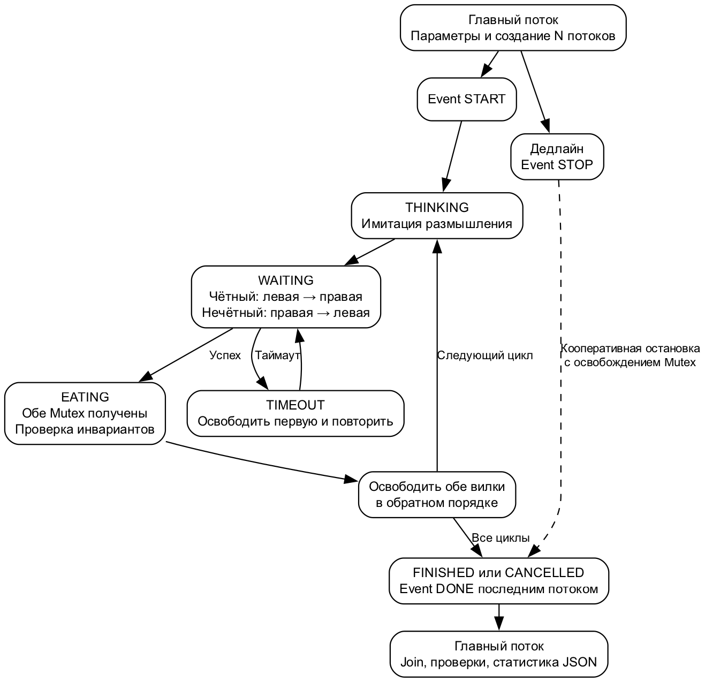
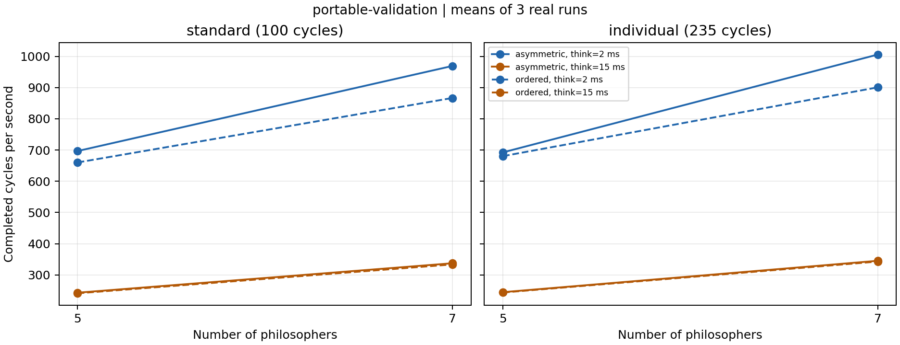
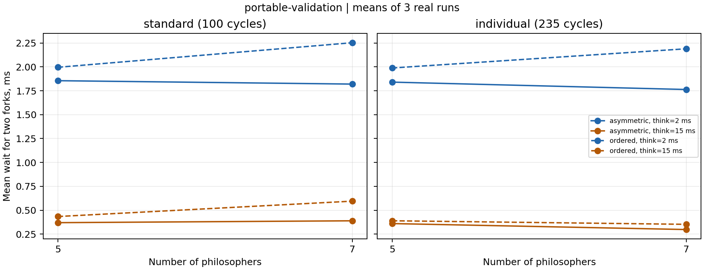

# Лабораторная работа 4

Вариант 4. Асимметричный захват вилок. STUDENT_ID=027.

# Оглавление

1. Введение

2. Цель работы

3. Постановка индивидуального задания

4. Краткие теоретические сведения

5. Архитектура программы

6. Потоки и общие ресурсы

7. Механизмы синхронизации

8. Алгоритм и предотвращение взаимной блокировки

9. Схемы взаимодействия

10. Использованные функции Windows API

11. Проверяемые инварианты

12. Методика экспериментов

13. Экспериментальные результаты

14. Графики и анализ

15. Заключение

16. Список источников

Приложение А  Использование искусственного интеллекта

Приложение Б  Сведения о Git

Приложение В  Исходники графических материалов

Приложение Г  Исходный код приложения

# 1 Введение

Конкурентный доступ к нескольким ресурсам требует одновременно исключить совместное владение одним ресурсом и предотвратить взаимную блокировку. Разработана консольная модель обедающих философов с отдельным Mutex для каждой вилки и асимметричным порядком захвата.

Представленные измерения получены в режиме portable-validation на macOS. Они проверяют алгоритм и средства сбора статистики. Испытания реализации Windows API в этой среде не выполнялись. Для завершения экспериментальной части по Windows необходимо запустить scripts/windows.ps1; он создаст отдельные исходные измерения и заново сформирует отчёт. Числа macOS нельзя использовать как результаты Windows.

# 2 Цель работы

Изучить взаимное исключение, блокирующее ожидание и согласованное завершение потоков Windows; реализовать модель варианта 4, проверить инварианты и исследовать влияние числа участников, продолжительности размышления и порядка захвата на время и ожидание ресурсов.

# 3 Постановка индивидуального задания

N философов сидят за круглым столом. На каждого приходится одна вилка между соседями. Приём пищи разрешён только после получения обеих соседних вилок. Чётные номера сначала берут левую вилку, нечётные — правую. Основной механизм — Mutex. Исследуются N=5 и N=7, продолжительности размышления 2 и 15 мс.

Нумерация в программе начинается с нуля. Для философа i левая вилка L=i, правая R=(i+1) mod N. Каждый выполняет C циклов THINKING → WAITING → EATING → THINKING, затем FINISHED. Число вилок всегда N, поскольку это условие модели.

| Параметр | Стандартный | Индивидуальный |
| --- | --- | --- |
| STUDENT_ID | 027 | 027 |
| SEED | 1000 | 1000 + 27 × 97 = 3619 |
| Циклов на философа | 100 | 100 + 27 × 5 = 235 |
| N | 5 и 7 | 5 и 7 |
| THINK мс | 2 и 15 | 2 и 15 |
| EAT мс | 2 | 2 |
| JITTER мс | 1 | 1 |
| Таймаут пары мс | 1000 | 1000 |
| Дедлайн мс | 60000 | 60000 |

JITTER означает равномерное целочисленное отклонение от номинальной задержки в пределах ±1 мс с отсечением отрицательных значений. --jitter-ms 0 задаёт строго постоянные задержки. Режим ordered служит дополнительной контрольной конфигурацией: сначала берётся вилка с меньшим номером.

# 4 Краткие теоретические сведения

Конкурентность означает пересечение интервалов выполнения, параллелизм — физическое одновременное выполнение. Общие данные становятся критическим ресурсом, если несогласованный доступ нарушает их целостность. Критическая секция объединяет действия, которые должны выполняться одним потоком за раз. Атомарность означает неделимость наблюдаемого изменения; составное действие из нескольких атомарных шагов само по себе атомарным не становится.

Состояние гонки возникает, когда результат зависит от несогласованного порядка доступа. Mutex обеспечивает одного владельца вилки. Проверка флага без блокировки не заменяет атомарного захвата: два потока могли бы одновременно увидеть свободную вилку. Служебные массивы также требуют отдельной защиты.

Условия Коффмана: взаимное исключение, удержание ресурса при ожидании другого, отсутствие принудительного изъятия и круговое ожидание. Асимметрия устраняет последнее условие. Голодание означает неограниченное ожидание отдельного участника при продвижении остальных. Оно отличается от deadlock всех участников. Наблюдаемое завершение опытов не доказывает справедливость Mutex [1].

При активном ожидании поток многократно проверяет условие и расходует процессорное время. Здесь ожидание блокирующее: Windows переводит поток в ожидание объекта. Задержки моделируют действия философа; они не обеспечивают взаимное исключение. Приоритеты потоков не изменяются. Пропускная способность измеряется числом завершённых циклов в секунду.

Другие модели решают родственные задачи: читатели–писатели допускают совместное чтение и исключительную запись; очередь обслуживания ограничивает буфер и регулирует производителей и потребителей; параллельная обработка памяти требует защиты обновлений и барьеров завершения этапов. Для текущего варианта используется именно модель философов.

# 5 Архитектура программы

src/main.cpp содержит параметры, модель, журнал, проверки и сбор статистики. src/platform.hpp инкапсулирует системные объекты. По умолчанию сборка разрешена только под Windows. LAB_PORTABLE=ON явно включает отдельный проверочный backend на std::thread, timed_mutex и condition_variable. В JSON backend записывается обязательно; скрипт запрещает смешивать результаты.

Главный поток создаёт контекст и все объекты, запускает работников и открывает START. Длительность отсчитывается до создания первого потока и заканчивается после join последнего, поэтому включает создание и завершение потоков, но исключает вывод итогового JSON. Рабочие потоки сохраняют данные только в собственную статистику. Главный читает её после ожидания завершения.

# 6 Потоки и общие ресурсы

| Объект | Количество | Назначение |
| --- | --- | --- |
| Главный поток | 1 | Параметры, дедлайн, join, итог |
| Философ | N | Размышление, захват, еда |
| Mutex вилки | N | Исключительное владение |
| Event | 3 | START, STOP, DONE |
| CRITICAL_SECTION | 2 | Монитор инвариантов и журнал |
| Статистика | N | Пишет только свой поток |

Монитор защищает owners и eating, но не назначает право владения вилкой. Это право даёт только Mutex. Во время ожидания вилки монитор и журнал не удерживаются. Короткая проверка сериализует наблюдение инвариантов и добавляет некоторую измерительную нагрузку, одинаковую для сравниваемых режимов.

# 7 Механизмы синхронизации

Mutex создаются неименованными: все потоки находятся в одном процессе. Именованные объекты нужны при независимых процессах. CRITICAL_SECTION, SRWLOCK и CONDITION_VARIABLE не являются средствами взаимодействия независимых процессов. Для текущей модели достаточно Mutex, Event, критических секций и атомарных счётчиков; демонстрация всех объектов из методички для одного варианта не требуется.

При ожидании вилки WaitForMultipleObjects получает два объекта: STOP с индексом 0 и Mutex с индексом 1, bWaitAll=FALSE. Поэтому STOP позволяет прервать ожидание ресурса. Если оба готовы, выбирается меньший индекс [2]. WAIT_TIMEOUT приводит к освобождению первой вилки и повтору после задержки 1–3 мс. Эта задержка снижает частоту повторов, но не является основой доказательства отсутствия deadlock.

WAIT_ABANDONED означает получение покинутого Mutex и ненадёжность защищаемого состояния. Программа освобождает полученный Mutex, регистрирует ошибку и останавливает эксперимент [1, 2]. WAIT_FAILED и ошибки создания/освобождения также обрабатываются. Захваты обёрнуты в RAII; дескрипторы закрываются после завершения потоков.

```cpp
HANDLE hs[] = {stop.get(), h_.get()};
DWORD r = WaitForMultipleObjects(2, hs, FALSE, ms);
if (r == WAIT_OBJECT_0 || r == WAIT_TIMEOUT) return false;
if (r == WAIT_OBJECT_0 + 1) return true;
```

При достижении дедлайна главный поток устанавливает STOP. Имитация размышления и еды выполнена ожиданием STOP с тайм-аутом, что позволяет быстро прервать даже длинную операцию. Последний работник устанавливает DONE. Затем главный ожидает дескрипторы потоков и закрывает их. TerminateThread не применяется. При невозможности остановки за 5 секунд программа аварийно завершает весь процесс с кодом 3, не разрушая используемые потоком объекты.

# 8 Алгоритм и предотвращение взаимной блокировки

```cpp
int left = id, right = (id + 1) % n;
int first  = id % 2 == 0 ? left  : right;
int second = id % 2 == 0 ? right : left;
// First mutex, then second within the remaining attempt timeout.
// On timeout RAII releases the first mutex before retrying.
```

Для N≥3 возможные зависимости между ресурсами имеют вид i→i+1 при чётном i и i+1→i при нечётном i, индексы берутся по модулю N. Неориентированный граф ресурсов — кольцо. Его единственный простой цикл использует все рёбра. Чтобы получить ориентированный цикл ожидания, все рёбра кольца должны идти в одном направлении. При N≥3 присутствуют чётные и нечётные участники, значит, направления различаются. Ориентированный цикл невозможен. Это верно и для нечётного N: рёбра двух чётных философов у границы нумерации не превращают всё кольцо в однонаправленное.

Для N=2 обе последовательности равны 0→1, поэтому циклическая зависимость также невозможна. Контрольный ordered предотвращает цикл глобальным возрастающим порядком ресурсов. Тайм-аут и STOP дополнительно ограничивают зависание при ошибке, но доказательство асимметричного алгоритма не опирается на тайм-аут. Без предположения о справедливом планировании отсутствие голодания не гарантируется.

# 9 Схемы взаимодействия



Схема построена Graphviz. Редактируемый исходник diagrams/architecture.dot, аналогичное описание Mermaid — diagrams/architecture.mmd. Перестроение: dot -Tpng -Gdpi=160 diagrams/architecture.dot -o diagrams/architecture.png. Исходники приведены в приложении В.

# 10 Использованные функции Windows API

| Функция | Использование |
| --- | --- |
| CreateMutexW, ReleaseMutex | Создание и освобождение вилок |
| CreateEventW, SetEvent | Ручные события START STOP DONE |
| WaitForMultipleObjects | Ожидание STOP или вилки |
| WaitForSingleObject | События и завершение потоков |
| InitializeCriticalSectionEx | Инициализация служебной защиты |
| EnterCriticalSection, LeaveCriticalSection | Монитор и потокобезопасный журнал |
| DeleteCriticalSection | Освобождение служебной защиты |
| GetCurrentThreadId | TID в журнале и JSON |
| QueryPerformanceCounter, QueryPerformanceFrequency | Монотонное измерение интервалов [3] |
| CloseHandle, GetLastError | Очистка и диагностика ошибок |
| _beginthreadex | Создание потока через CRT [4] |

_beginthreadex является функцией CRT, создающей системный поток Windows и корректно подготавливающей среду C/C++. Возвращаемый дескриптор ожидается средствами Windows API и закрывается явно. std::atomic используется для счётчиков errors, violations и exited; статистика отдельного участника не требует межпоточной записи.

# 11 Проверяемые инварианты

При получении вилки её служебный владелец должен быть -1; при освобождении — текущий философ. В начале еды обе вилки должны принадлежать этому философу, сам он и его соседи не должны уже есть. Одновременно едят не более floor(N/2) участников. После join владельцы всех вилок равны -1, все признаки eating сброшены. Итоговое число операций должно равняться N×C; каждый поток должен завершить C циклов для статуса OK.

Все наблюдения owners/eating выполняются под монитором. Ошибки API и недовыполнение считаются отдельно от нарушений инвариантов. Код возврата 0 означает полное успешное выполнение; 1 — ошибку аргументов или инициализации/вывода; 2 — неполное выполнение, дедлайн, ошибки работников или нарушения; 3 — аварийную невозможность остановки. Нулевое число обнаруженных нарушений является результатом испытаний, а не самостоятельным доказательством корректности.

tests/test_app.py проверяет 2, 3, 5, 7, 8, 16 и 32 потока в обоих режимах; тайм-аут 1 мс при конкуренции; дедлайн 20 мс во время длинной еды; индивидуальный набор и приоритет явных параметров; некорректные аргументы и формат журнала. Программный контроль остатков ресурсов действует и при отмене.

# 12 Методика экспериментов

Среда фактических измерений: macOS-26.6.2-arm64-arm-64bit-Mach-O; backend=portable-validation; процессор=arm; Python=3.14.7. Время создания серии UTC: 2026-10-24T06:15:24.244648+00:00. Хеш исполняемого файла SHA-256: c17c30daa5fa38f21707fb0315a58e3444260f2807093a2cfe219c092f1bf451.

Матрица: 2 набора циклов и seed × 2 порядка захвата × 2 количества философов × 2 продолжительности размышления = 16 конфигураций. Каждая запущена 3 раза, всего 48. Лог отключён --quiet. EAT=2±1 мс, THINK=T±1 мс, тайм-аут пары 1000 мс, дедлайн 60000 мс. Все остальные параметры неизменны. Для каждого повтора используется один seed, изменяется только естественное планирование ОС.

Для каждого потока xorshift32 инициализируется seed XOR (0x9e3779b9×(id+1)) по модулю 2^32. Нулевое состояние заменяется единицей. При тайм-аутах расход генератора зависит от числа повторов, поэтому фиксированный seed не задаёт идентичную трассу при разном планировании. Полные команды, хеши сырых файлов и платформа находятся в manifest.json.

Время T измерено монотонным счётчиком. Пропускная способность Q=1000×(N×C)/T. Среднее ожидание — сумма интервалов от первого запроса до получения обеих вилок в успешно завершённых циклах, делённая на число этих циклов; включает повторы и задержки между ними. Максимум — наибольшее такое ожидание до входа в еду. Доля использования U=2×сумма длительностей EATING/(N×T), то есть доля времени ресурсов, занятых именно едой. Удержание одной вилки при ожидании второй в U не включается.

Таблица содержит среднее арифметическое трёх запусков. summary.csv также содержит выборочное стандартное отклонение времени (делитель n−1), пропускную способность и загрузку. workers.csv сохраняет индивидуальные ожидания, попытки и операции. Исходные JSON не перезаписываются скриптом. analyze.py проверяет SHA-256, полноту и backend перед построением графиков.

# 13 Экспериментальные результаты

Обозначение S — стандартные 100 циклов, I — индивидуальные 235; A — asymmetric, O — ordered. Имя конфигурации содержит N и номинальное T размышления.

Таблица 1. Время выполнения, мс

| Набор/режим/N/T | Запуск 1 | Запуск 2 | Запуск 3 | Среднее |
| --- | --- | --- | --- | --- |
| I/A/5/2 | 1698.84 | 1695.39 | 1695.95 | 1696.73 |
| I/A/5/15 | 4793.40 | 4775.51 | 4821.01 | 4796.64 |
| I/A/7/2 | 1617.70 | 1650.60 | 1639.83 | 1636.04 |
| I/A/7/15 | 4761.62 | 4789.46 | 4735.71 | 4762.27 |
| I/O/5/2 | 1716.06 | 1737.69 | 1726.26 | 1726.67 |
| I/O/5/15 | 4788.23 | 4851.80 | 4818.26 | 4819.43 |
| I/O/7/2 | 1796.50 | 1847.45 | 1836.43 | 1826.79 |
| I/O/7/15 | 4834.22 | 4795.05 | 4762.27 | 4797.18 |
| S/A/5/2 | 721.98 | 718.16 | 712.58 | 717.57 |
| S/A/5/15 | 2034.15 | 2052.41 | 2079.07 | 2055.21 |
| S/A/7/2 | 733.94 | 728.68 | 705.13 | 722.58 |
| S/A/7/15 | 2062.23 | 2055.42 | 2105.31 | 2074.32 |
| S/O/5/2 | 767.84 | 752.36 | 752.00 | 757.40 |
| S/O/5/15 | 2098.68 | 2082.98 | 2034.25 | 2071.97 |
| S/O/7/2 | 783.21 | 840.32 | 802.02 | 808.51 |
| S/O/7/15 | 2100.74 | 2069.15 | 2123.91 | 2097.93 |

Таблица 2. Профильные показатели. Операции указаны за один запуск; тайм-ауты и нарушения — сумма по трём запускам. Ожидание — среднее по трём запускам, максимум — максимум серии.

| Конфигурация | Операции | Ожидание мс | Макс мс | Тайм-ауты | Нарушения |
| --- | --- | --- | --- | --- | --- |
| I/A/5/2 | 1175 | 1.841 | 10.024 | 0 | 0 |
| I/A/5/15 | 1175 | 0.360 | 7.585 | 0 | 0 |
| I/A/7/2 | 1645 | 1.763 | 10.429 | 0 | 0 |
| I/A/7/15 | 1645 | 0.298 | 7.393 | 0 | 0 |
| I/O/5/2 | 1175 | 1.989 | 15.079 | 0 | 0 |
| I/O/5/15 | 1175 | 0.389 | 7.784 | 0 | 0 |
| I/O/7/2 | 1645 | 2.190 | 13.496 | 0 | 0 |
| I/O/7/15 | 1645 | 0.352 | 9.659 | 0 | 0 |
| S/A/5/2 | 500 | 1.856 | 8.860 | 0 | 0 |
| S/A/5/15 | 500 | 0.370 | 7.112 | 0 | 0 |
| S/A/7/2 | 700 | 1.820 | 11.385 | 0 | 0 |
| S/A/7/15 | 700 | 0.389 | 13.886 | 0 | 0 |
| S/O/5/2 | 500 | 1.996 | 13.828 | 0 | 0 |
| S/O/5/15 | 500 | 0.434 | 7.482 | 0 | 0 |
| S/O/7/2 | 700 | 2.253 | 15.026 | 0 | 0 |
| S/O/7/15 | 700 | 0.595 | 11.255 | 0 | 0 |

Во всех 48 выполненных запусках получен статус success, ошибок и нарушений инвариантов не обнаружено. Каждый участник выполнил заданное число циклов. Всего завершено 48240 циклов. Это наблюдение относится к указанному backend.

# 14 Графики и анализ





Ожидалось, что увеличение THINK с 2 до 15 мс уменьшит конкуренцию за вилки и среднее ожидание, но увеличит общую длительность. Увеличение N добавляет одновременно и участников, и вилки; потому число возможных одновременно едящих растёт с 2 до 3. Изменение пропускной способности не обязано быть пропорционально N.

Для стандартного набора, N=5, asymmetric: при THINK 2→15 мс среднее время изменилось 717.57→2055.21 мс, пропускная способность 696.81→243.30 циклов/с, ожидание 1.856→0.370 мс.

Для стандартного набора, N=7, asymmetric: при THINK 2→15 мс среднее время изменилось 722.58→2074.32 мс, пропускная способность 969.04→337.50 циклов/с, ожидание 1.820→0.389 мс.

Для индивидуального набора, N=5, asymmetric: при THINK 2→15 мс среднее время изменилось 1696.73→4796.64 мс, пропускная способность 692.51→244.97 циклов/с, ожидание 1.841→0.360 мс.

Для индивидуального набора, N=7, asymmetric: при THINK 2→15 мс среднее время изменилось 1636.04→4762.27 мс, пропускная способность 1005.55→345.43 циклов/с, ожидание 1.763→0.298 мс.

Отношение среднего времени ordered/asymmetric лежит в пределах 1.005–1.119. Оба режима используют Mutex, поэтому сравнение характеризует влияние порядка захвата при одной и той же защите. Оно не измеряет отдельную стоимость Mutex относительно небезопасного доступа без синхронизации.

Отклонения объясняются конкуренцией соседей, удержанием первой вилки, планированием, переключениями контекста, квантованием таймеров и служебными проверками. Фактическая задержка ОС может превышать заданную. Три повтора показывают вариативность, но не обеспечивают строгой статистической значимости небольших различий. Число завершённых операций одинаково для всех участников внутри опыта, однако это следует из конечного задания, а не из гарантии справедливости Mutex.

Переносить численные выводы о скорости и таймерах на Windows нельзя. После Windows-серии следует анализировать заново сформированные таблицы и графики. Доказательство отсутствия кругового ожидания относится к алгоритму обоих backend.

# 15 Заключение

Разработана параметризуемая модель варианта 4 с асимметричным захватом вилок, журналом состояний, контролем инвариантов, тайм-аутами и кооперативным завершением. Отсутствие взаимной блокировки обосновано разрывом кругового ожидания. Выполненные испытания завершились без обнаруженных нарушений. Гарантия отсутствия голодания не заявляется.

До завершения лабораторной по заданию остаются выполнение Windows-серии, публикация репозитория с доступом преподавателю, заполнение личных полей титульного листа и защита с дополнительными параметрами преподавателя.

# 16 Список источников

[1] Microsoft Learn. Mutex Objects. https://learn.microsoft.com/en-us/windows/win32/sync/mutex-objects

[2] Microsoft Learn. WaitForMultipleObjects. https://learn.microsoft.com/en-us/windows/win32/api/synchapi/nf-synchapi-waitformultipleobjects

[3] Microsoft Learn. Acquiring high resolution time stamps. https://learn.microsoft.com/en-us/windows/win32/sysinfo/acquiring-high-resolution-time-stamps

[4] Microsoft Learn. _beginthreadex. https://learn.microsoft.com/en-us/cpp/c-runtime-library/reference/beginthread-beginthreadex

[5] Методические указания, предоставленные в задании. Лабораторная работа 4. Вариант 4.

[6] Git. Documentation. https://git-scm.com/docs

# Приложение А  Использование искусственного интеллекта

При подготовке работы использован ИИ помощник Codex. С его помощью подготовлены архитектура, исходный C++ код и адаптер Windows API, тесты, сценарии экспериментов, графики и текст отчёта. ИИ также запускал сборку и проверки в доступной среде. Нельзя представлять эти материалы как разработанные без ИИ. Точное имя модели в предоставленном интерфейсе не подтверждено.

Основной запрос: полностью подготовить лабораторную по взаимодействию потоков, вариант 4, STUDENT_ID=027, согласно методическим условиям. Автоматические измерения выполнялись реальной программой; вымышленные данные не использовались. Студент должен самостоятельно проверить Windows-результаты и уметь объяснить исходный код и ограничения доказательств.

# Приложение Б  Сведения о репозитории Git

Ниже приведена история, доступная при формировании отчёта. Хеш коммита, содержащего сам итоговый документ, смотрят командой git log после фиксации. История отражает реальные последовательные этапы, опубликованная история не переписывается.

```text
5562760 Добавлены проверки корректности таймаутов остановки и воспроизводимые испытания
655c3b7 Реализованы потоки философов и асимметричный захват Mutex Windows
7e33ea7 Спроектирована модель варианта 4 и создана структура лабораторной
```

Удалённый репозиторий: не настроен; URL и доступ преподавателю ещё не предоставлены.

Этапы: проектирование; базовая реализация; синхронизация и проверки; эксперименты и отчёт. Репозиторий создан во время выполнения работы. Регулярная отправка промежуточных версий в удалённый репозиторий во время этой подготовки не выполнялась. Это нельзя исправить имитацией прошлой истории.

```bash
git remote add origin URL
git push -u origin main
git log --oneline
git diff HASH1 HASH2
```

# Приложение В  Исходники графических материалов

Исходные данные: data/portable/manifest.json и 48 JSON; производные summary.csv и workers.csv. Файлы данных предоставляются в репозитории, значения основных измерений приведены в разделе 13. Скрипт ниже проверяет исходники и строит оба графика PNG/SVG.

## scripts  analyze py

```python
"""Verify source hashes and build tables and two plots from real measurements."""
import argparse
import csv
import hashlib
import json
import statistics as st
from collections import defaultdict
from pathlib import Path


def analyze(folder):
    manifest = json.loads((folder / 'manifest.json').read_text(encoding='utf-8'))
    groups = defaultdict(list)
    workers = []
    for rec in manifest['records']:
        path = folder / rec['file']
        if hashlib.sha256(path.read_bytes()).hexdigest() != rec['sha256']:
            raise ValueError(f'Raw measurement modified: {path}')
        d = json.loads(path.read_text())
        if d['backend'] != manifest['backend'] or not d['success'] or d['violations'] or d['errors']:
            raise ValueError(f'Failed or mixed-backend run: {path}')
        key = (rec['preset'], d['mode'], d['philosophers'], d['think_ms'])
        if (d['seed'], d['cycles']) != ((1000, 100) if rec['preset'] == 'standard' else (3619, 235)):
            raise ValueError(f'Incorrect preset: {path}')
        if d['completed'] != d['philosophers']*d['cycles'] or any(w['completed'] != d['cycles'] for w in d['workers']):
            raise ValueError(f'Incomplete run: {path}')
        groups[key].append((rec['repeat'], d))
        for w in d['workers']:
            workers.append({'file': rec['file'], **w})
    rows = []
    for (preset, mode, n, think), runs in sorted(groups.items()):
        runs.sort()
        if [r for r, _ in runs] != [1, 2, 3]: raise ValueError('Need exactly three repetitions')
        ds = [d for _, d in runs]
        times = [d['elapsed_ms'] for d in ds]
        row = dict(preset=preset, mode=mode, philosophers=n, think_ms=think,
                   run1_ms=times[0], run2_ms=times[1], run3_ms=times[2], mean_ms=st.mean(times),
                   std_ms=st.stdev(times), completed=ds[0]['completed'],
                   throughput_ops_s=st.mean(d['throughput_ops_s'] for d in ds),
                   mean_wait_ms=st.mean(d['mean_wait_ms'] for d in ds),
                   max_wait_ms=max(d['max_wait_ms'] for d in ds),
                   utilization=st.mean(d['resource_utilization'] for d in ds),
                   timeouts=sum(d['timeouts'] for d in ds), violations=sum(d['violations'] for d in ds))
        rows.append(row)
    if len(rows) != 16: raise ValueError('Suite requires 16 configurations')
    for name, values in [('summary.csv', rows), ('workers.csv', workers)]:
        with (folder / name).open('w', newline='', encoding='utf-8') as f:
            writer = csv.DictWriter(f, fieldnames=list(values[0])); writer.writeheader(); writer.writerows(values)
    return manifest, rows


def plot(folder, manifest, rows):
    import matplotlib
    matplotlib.use('Agg')
    import matplotlib.pyplot as plt
    backend = manifest['backend']
    # Two independent characteristics, all mandatory configurations and comparison mode.
    for field, ylabel, filename in [('throughput_ops_s', 'Completed cycles per second', 'throughput'),
                                    ('mean_wait_ms', 'Mean wait for two forks, ms', 'waiting')]:
        fig, axes = plt.subplots(1, 2, figsize=(10.4, 4), sharey=True, layout='constrained')
        for ax, preset in zip(axes, ['standard', 'individual']):
            for mode, style in [('asymmetric', '-'), ('ordered', '--')]:
                for think, color in [(2, '#2166ac'), (15, '#b35806')]:
                    rs = sorted((r for r in rows if r['preset'] == preset and r['mode'] == mode and r['think_ms'] == think), key=lambda r: r['philosophers'])
                    ax.plot([r['philosophers'] for r in rs], [r[field] for r in rs], style,
                            marker='o', color=color, label=f'{mode}, think={think} ms')
            ax.set_title(preset + (' (100 cycles)' if preset == 'standard' else ' (235 cycles)'))
            ax.set_xlabel('Number of philosophers'); ax.set_xticks([5, 7]); ax.grid(alpha=.25)
        axes[0].set_ylabel(ylabel)
        axes[1].legend(fontsize=7)
        fig.suptitle(f'{backend} | means of 3 real runs', fontsize=11)
        fig.savefig(folder / f'{filename}.png', dpi=180)
        fig.savefig(folder / f'{filename}.svg')
        plt.close(fig)

if __name__ == '__main__':
    p = argparse.ArgumentParser(description=__doc__); p.add_argument('--data', type=Path, required=True)
    a = p.parse_args(); m, r = analyze(a.data); plot(a.data, m, r)
    print(f'Validated {len(m["records"])} runs; wrote tables and plots to {a.data}')
```

## diagrams  architecture dot

```text
digraph architecture {
  graph [rankdir=TB, bgcolor=white, fontname="Arial", nodesep=.25, ranksep=.3];
  node [shape=box, style="rounded", fontname="Arial", fontsize=11, margin=".12,.08"];
  edge [fontname="Arial", fontsize=10];
  main [label="Главный поток\nПараметры и создание N потоков"];
  start [label="Event START"];
  think [label="THINKING\nИмитация размышления"];
  wait [label="WAITING\nЧётный: левая → правая\nНечётный: правая → левая"];
  eat [label="EATING\nОбе Mutex получены\nПроверка инвариантов"];
  release [label="Освободить обе вилки\nв обратном порядке"];
  retry [label="TIMEOUT\nОсвободить первую и повторить"];
  finish [label="FINISHED или CANCELLED\nEvent DONE последним потоком"];
  report [label="Главный поток\nJoin, проверки, статистика JSON"];
  stop [label="Дедлайн\nEvent STOP"];
  main -> start -> think -> wait;
  wait -> eat [label="Успех"];
  wait -> retry [label="Таймаут"];
  retry -> wait;
  eat -> release;
  release -> think [label="Следующий цикл"];
  release -> finish [label="Все циклы"];
  finish -> report;
  main -> stop;
  stop -> finish [style=dashed, label="Кооперативная остановка\nс освобождением Mutex"];
}
```

## diagrams  architecture mmd

```text
flowchart TD
    A[Главный поток и параметры] --> B[Создать N Mutex вилок и N потоков]
    B --> C[Event START общий старт]
    C --> D[Философ i]
    D --> E[THINKING]
    E --> F[WAITING]
    F --> G{Чётный номер}
    G -->|Да| H[Левая затем правая Mutex]
    G -->|Нет| I[Правая затем левая Mutex]
    H --> J{Обе получены}
    I --> J
    J -->|Да| K[Проверить инварианты и EATING]
    J -->|Таймаут| L[Освободить первую вилку и повторить]
    L --> F
    K --> M[Освободить обе вилки]
    M --> N{Все циклы выполнены}
    N -->|Нет| E
    N -->|Да| O[FINISHED]
    A --> P[Контроль дедлайна]
    P --> Q[Event STOP]
    Q --> D
    O --> R[Ожидание потоков и итоговые проверки]
    R --> S[JSON статистика и журнал]
```

# Приложение Г  Исходный код приложения

Полная реализация состоит из следующих двух файлов. Проект Visual Studio подключает тот же main.cpp. Сборка, проверки и воспроизведение описаны в README.md. Сценарий серии приведён после C++ кода.

## src  platform hpp

```cpp
#pragma once
#include <chrono>
#include <cstdint>
#include <stdexcept>
#include <string>
#if defined(_WIN32) && !defined(LAB_PORTABLE)
#define NOMINMAX
#include <windows.h>
#include <process.h>
#else
#include <condition_variable>
#include <mutex>
#include <thread>
#include <functional>
#ifdef __APPLE__
#include <pthread.h>
#endif
#endif

namespace os {
#if defined(_WIN32) && !defined(LAB_PORTABLE)
inline constexpr const char* backend = "windows-api";
inline std::runtime_error error(const char* name) {
    return std::runtime_error(std::string(name) + " GetLastError=" + std::to_string(GetLastError()));
}
class Handle {
    HANDLE h_;
public:
    explicit Handle(HANDLE h): h_(h) { if (!h_) throw error("Create object"); }
    ~Handle() { if (!CloseHandle(h_)) std::terminate(); }
    Handle(const Handle&) = delete;
    HANDLE get() const { return h_; }
};
class Event {
    Handle h_{CreateEventW(nullptr, TRUE, FALSE, nullptr)};
public:
    void set() { if (!SetEvent(h_.get())) throw error("SetEvent"); }
    bool wait(uint32_t ms) {
        DWORD r = WaitForSingleObject(h_.get(), ms);
        if (r == WAIT_OBJECT_0) return true;
        if (r == WAIT_TIMEOUT) return false;
        throw error("WaitForSingleObject event");
    }
    HANDLE get() const { return h_.get(); }
};
class Mutex {
    Handle h_{CreateMutexW(nullptr, FALSE, nullptr)};
public:
    bool acquire(Event& stop, uint32_t ms) {
        HANDLE hs[] = {stop.get(), h_.get()};
        DWORD r = WaitForMultipleObjects(2, hs, FALSE, ms);
        if (r == WAIT_OBJECT_0 || r == WAIT_TIMEOUT) return false;
        if (r == WAIT_OBJECT_0 + 1) return true;
        if (r == WAIT_ABANDONED_0 + 1) {
            if (!ReleaseMutex(h_.get())) throw error("Release abandoned Mutex");
            throw std::runtime_error("Abandoned Mutex: shared state is unreliable");
        }
        throw error("WaitForMultipleObjects");
    }
    void release() { if (!ReleaseMutex(h_.get())) throw error("ReleaseMutex"); }
};
class Lock {
    CRITICAL_SECTION cs_;
public:
    Lock() { if (!InitializeCriticalSectionEx(&cs_, 0, 0)) throw error("InitializeCriticalSectionEx"); }
    ~Lock() { DeleteCriticalSection(&cs_); }
    void lock() { EnterCriticalSection(&cs_); }
    void unlock() { LeaveCriticalSection(&cs_); }
};
using Entry = unsigned (__stdcall *)(void*);
class Thread {
    Handle h_;
public:
    Thread(Entry entry, void* arg): h_(reinterpret_cast<HANDLE>(_beginthreadex(nullptr, 0, entry, arg, 0, nullptr))) {}
    void join() {
        DWORD r = WaitForSingleObject(h_.get(), 5000);
        if (r != WAIT_OBJECT_0) throw std::runtime_error("Thread join failed or exceeded 5 s");
    }
};
inline uint64_t tid() { return GetCurrentThreadId(); }
inline double now_ms() {
    static const double f = [] { LARGE_INTEGER x; if (!QueryPerformanceFrequency(&x)) throw error("QPF"); return double(x.QuadPart); }();
    LARGE_INTEGER x; if (!QueryPerformanceCounter(&x)) throw error("QPC");
    return double(x.QuadPart) * 1000.0 / f;
}
#define THREAD_ENTRY unsigned __stdcall
#else
inline constexpr const char* backend = "portable-validation";
class Event {
    std::mutex m_; std::condition_variable cv_; bool signaled_ = false;
public:
    void set() { { std::lock_guard<std::mutex> g(m_); signaled_ = true; } cv_.notify_all(); }
    bool wait(uint32_t ms) {
        std::unique_lock<std::mutex> g(m_);
        return cv_.wait_for(g, std::chrono::milliseconds(ms), [&] { return signaled_; });
    }
};
class Mutex {
    std::timed_mutex m_;
public:
    bool acquire(Event& stop, uint32_t ms) {
        const auto end = std::chrono::steady_clock::now() + std::chrono::milliseconds(ms);
        do {
            if (stop.wait(0)) return false;
            auto left = std::chrono::duration_cast<std::chrono::milliseconds>(end - std::chrono::steady_clock::now()).count();
            if (m_.try_lock_for(std::chrono::milliseconds(left > 10 ? 10 : (left > 0 ? left : 0)))) return true;
        } while (std::chrono::steady_clock::now() < end);
        return false;
    }
    void release() { m_.unlock(); }
};
using Lock = std::mutex;
using Entry = unsigned (*)(void*);
class Thread {
    std::thread t_;
public:
    Thread(Entry entry, void* arg): t_([=] { entry(arg); }) {}
    void join() { t_.join(); }
};
inline uint64_t tid() {
#ifdef __APPLE__
    uint64_t id = 0; pthread_threadid_np(nullptr, &id); return id;
#else
    return std::hash<std::thread::id>{}(std::this_thread::get_id());
#endif
}
inline double now_ms() { return std::chrono::duration<double, std::milli>(std::chrono::steady_clock::now().time_since_epoch()).count(); }
#define THREAD_ENTRY unsigned
#endif
class Guard {
    Lock& l_;
public:
    explicit Guard(Lock& l): l_(l) { l_.lock(); }
    ~Guard() { l_.unlock(); }
    Guard(const Guard&) = delete;
};
}
```

## src  main cpp

```cpp
#include "platform.hpp"
#include <algorithm>
#include <atomic>
#include <cmath>
#include <cstdlib>
#include <fstream>
#include <iomanip>
#include <iostream>
#include <memory>
#include <sstream>
#include <vector>

struct Config {
    int philosophers = 5, cycles = 100, think = 2, eat = 2, jitter = 1;
    uint32_t seed = 1000, timeout = 1000, duration = 60000;
    bool quiet = false, individual = false;
    std::string mode = "asymmetric", json;
};
int number(const std::string& s, int lo, int hi) {
    size_t end = 0; long long n = std::stoll(s, &end);
    if (end != s.size() || n < lo || n > hi) throw std::runtime_error("Invalid numeric value: " + s);
    return static_cast<int>(n);
}
Config parse(int argc, char** argv) {
    Config c;
    // Preset is applied first, explicit arguments always override it.
    for (int i = 1; i < argc; ++i) if (std::string(argv[i]) == "--individual") c.individual = true;
    if (c.individual) { c.seed = 3619; c.cycles = 235; }
    for (int i = 1; i < argc; ++i) {
        std::string a = argv[i];
        if (a == "--individual") continue;
        if (a == "--quiet") { c.quiet = true; continue; }
        if (a == "--help") {
            std::cout << "Variant 4, IDs 0..N-1, left=i, right=(i+1)%N\n"
                      << "--individual (ID=027 seed=3619 cycles=235) --quiet\n"
                      << "--philosophers 2..32 --cycles 1..1000000 --think-ms 0..10000\n"
                      << "--eat-ms 0..10000 --jitter-ms 0..1000 --seed 0..2147483647\n"
                      << "--timeout-ms 1..60000 --duration-ms 1..3600000\n"
                      << "--mode asymmetric|ordered --json FILE\n";
            std::exit(0);
        }
        if (++i == argc) throw std::runtime_error("Missing value for " + a);
        const std::string v = argv[i];
        if (a == "--philosophers") c.philosophers = number(v, 2, 32);
        else if (a == "--cycles") c.cycles = number(v, 1, 1000000);
        else if (a == "--think-ms") c.think = number(v, 0, 10000);
        else if (a == "--eat-ms") c.eat = number(v, 0, 10000);
        else if (a == "--jitter-ms") c.jitter = number(v, 0, 1000);
        else if (a == "--seed") c.seed = static_cast<uint32_t>(number(v, 0, 2147483647));
        else if (a == "--timeout-ms") c.timeout = static_cast<uint32_t>(number(v, 1, 60000));
        else if (a == "--duration-ms") c.duration = static_cast<uint32_t>(number(v, 1, 3600000));
        else if (a == "--json") c.json = v;
        else if (a == "--mode" && (v == "asymmetric" || v == "ordered")) c.mode = v;
        else throw std::runtime_error("Unknown argument or value: " + a + " " + v);
    }
    return c;
}
struct Stats {
    uint64_t tid = 0;
    int completed = 0, attempts = 0, timeouts = 0;
    double wait_total = 0, wait_success = 0, wait_max = 0, eating_ms = 0;
};
struct Context;
struct Worker { Context* ctx; int id; Stats stats; };
struct Context {
    Config c;
    std::vector<std::unique_ptr<os::Mutex>> forks;
    std::vector<int> owners;
    std::vector<bool> eating;
    std::vector<Worker> workers;
    os::Event start, stop, done;
    os::Lock monitor, logger;
    std::atomic<int> violations{0}, errors{0}, exited{0};
    double started = 0;
    explicit Context(Config cfg): c(std::move(cfg)), owners(c.philosophers, -1), eating(c.philosophers, false) {
        for (int i = 0; i < c.philosophers; ++i) {
            forks.emplace_back(std::make_unique<os::Mutex>());
            workers.push_back({this, i, {}});
        }
    }
    void log(int id, const char* event, int resource = -1) {
        if (c.quiet) return;
        os::Guard g(logger);
        std::cout << '[' << std::fixed << std::setprecision(3) << os::now_ms() - started
                  << " ms] P" << id << " TID=" << os::tid() << ' ' << event;
        if (resource >= 0) std::cout << " RESOURCE=" << resource;
        std::cout << '\n';
    }
    void check(bool condition) { if (!condition) ++violations; }
};
// A guard is created before acquisition, so all acquired resources have an owner.
class ForkGuard {
    Context& x_; int id_, fork_; bool held_ = false;
public:
    ForkGuard(Context& x, int id, int fork): x_(x), id_(id), fork_(fork) {}
    bool acquire(uint32_t timeout) {
        x_.log(id_, "WAITING", fork_);
        if (!x_.forks[fork_]->acquire(x_.stop, timeout)) return false;
        held_ = true;
        { os::Guard g(x_.monitor); x_.check(x_.owners[fork_] == -1); x_.owners[fork_] = id_; }
        x_.log(id_, "ACQUIRED", fork_);
        return true;
    }
    ~ForkGuard() {
        if (!held_) return;
        try {
            // Monitor release precedes kernel release; new owner cannot enter yet.
            { os::Guard g(x_.monitor); x_.check(x_.owners[fork_] == id_); x_.owners[fork_] = -1; }
            x_.log(id_, "RELEASED", fork_);
            x_.forks[fork_]->release();
        } catch (...) { ++x_.errors; try { x_.stop.set(); } catch (...) {} }
    }
};
uint32_t random_next(uint32_t& s) { s ^= s << 13; s ^= s >> 17; s ^= s << 5; return s; }
uint32_t delay(int base, int jitter, uint32_t& s) {
    int delta = static_cast<int>(random_next(s) % static_cast<uint32_t>(2*jitter+1)) - jitter;
    return static_cast<uint32_t>(std::max(0, base+delta));
}
void run(Worker& w) {
    Context& x = *w.ctx; auto& s = w.stats; const int id = w.id, n = x.c.philosophers;
    s.tid = os::tid();
    while (!x.start.wait(50)) if (x.stop.wait(0)) return;
    uint32_t rng = x.c.seed ^ (0x9e3779b9u * static_cast<uint32_t>(id+1));
    if (!rng) rng = 1;
    for (int cycle = 0; cycle < x.c.cycles && !x.stop.wait(0); ++cycle) {
        x.log(id, "THINKING");
        if (x.stop.wait(delay(x.c.think, x.c.jitter, rng))) break;
        int left = id, right = (id+1)%n;
        int first = id%2 == 0 ? left : right;
        int second = id%2 == 0 ? right : left;
        if (x.c.mode == "ordered") { first = std::min(left, right); second = std::max(left, right); }
        const double waiting = os::now_ms();
        const double eating_before = s.eating_ms;
        bool ate = false;
        while (!x.stop.wait(0) && !ate) {
            ++s.attempts;
            bool retry = false;
            {
                ForkGuard a(x, id, first), b(x, id, second);
                const double attempt = os::now_ms();
                if (!a.acquire(x.c.timeout)) retry = true;
                else {
                    const double remaining = double(x.c.timeout) - (os::now_ms() - attempt);
                    if (remaining <= 0 || !b.acquire(static_cast<uint32_t>(std::ceil(remaining)))) retry = true;
                    else if (!x.stop.wait(0)) {
                        const double wait = os::now_ms() - waiting;
                        s.wait_max = std::max(s.wait_max, wait);
                        {
                            os::Guard g(x.monitor);
                            x.check(x.owners[left] == id && x.owners[right] == id);
                            x.check(!x.eating[id] && !x.eating[(id+n-1)%n] && !x.eating[(id+1)%n]);
                            x.eating[id] = true;
                            x.check(std::count(x.eating.begin(), x.eating.end(), true) <= n/2);
                        }
                        x.log(id, "EATING");
                        const double eating_start = os::now_ms();
                        bool interrupted = x.stop.wait(delay(x.c.eat, x.c.jitter, rng));
                        s.eating_ms += os::now_ms() - eating_start;
                        { os::Guard g(x.monitor); x.eating[id] = false; }
                        if (!interrupted) { ++s.completed; s.wait_success += wait; ate = true; }
                    }
                }
            } // reverse release, including first fork on timeout
            if (retry && !x.stop.wait(0)) {
                ++s.timeouts; x.log(id, "TIMEOUT");
                if (x.stop.wait(1 + random_next(rng)%3)) break;
            }
        }
        s.wait_total += os::now_ms() - waiting - (s.eating_ms - eating_before);
        if (ate) x.log(id, "CYCLE_DONE");
    }
    x.log(id, s.completed == x.c.cycles ? "FINISHED" : "CANCELLED");
}
THREAD_ENTRY entry(void* arg) {
    auto& w = *static_cast<Worker*>(arg); Context& x = *w.ctx;
    try { run(w); }
    catch (const std::exception& e) {
        ++x.errors;
        { os::Guard g(x.logger); std::cerr << "P" << w.id << " ERROR " << e.what() << '\n'; }
        try { x.stop.set(); } catch (...) {}
    }
    if (++x.exited == x.c.philosophers) { try { x.done.set(); } catch (...) { ++x.errors; } }
    return 0;
}
int execute(Config c) {
    Context x(std::move(c));
    std::vector<std::unique_ptr<os::Thread>> threads;
    threads.reserve(x.c.philosophers);
    x.started = os::now_ms();
    try {
        for (auto& w : x.workers) threads.emplace_back(std::make_unique<os::Thread>(entry, &w));
        x.start.set();
    } catch (...) {
        x.stop.set(); x.start.set();
        for (auto& t : threads) t->join();
        throw;
    }
    bool deadline = !x.done.wait(x.c.duration);
    if (deadline) x.stop.set();
    if (!x.done.wait(5000)) {
        std::cerr << "FATAL: workers did not stop within grace period\n";
        std::_Exit(3); // no destruction of objects still used by workers
    }
    for (auto& t : threads) t->join();
    const double elapsed = os::now_ms() - x.started;
    int completed = 0, timeouts = 0; double wait = 0, max_wait = 0, eat = 0;
    for (auto& w : x.workers) {
        completed += w.stats.completed; timeouts += w.stats.timeouts;
        wait += w.stats.wait_success; max_wait = std::max(max_wait, w.stats.wait_max); eat += w.stats.eating_ms;
    }
    for (int i = 0; i < x.c.philosophers; ++i) { x.check(x.owners[i] == -1); x.check(!x.eating[i]); }
    const bool success = !deadline && x.errors == 0 && x.violations == 0 && completed == x.c.philosophers*x.c.cycles;
    std::ostringstream out;
    out << std::fixed << std::setprecision(6)
        << "{\n  \"backend\":\"" << os::backend << "\",\n  \"mode\":\"" << x.c.mode
        << "\",\n  \"seed\":" << x.c.seed << ",\n  \"philosophers\":" << x.c.philosophers
        << ",\n  \"cycles\":" << x.c.cycles << ",\n  \"think_ms\":" << x.c.think
        << ",\n  \"eat_ms\":" << x.c.eat << ",\n  \"jitter_ms\":" << x.c.jitter
        << ",\n  \"timeout_ms\":" << x.c.timeout << ",\n  \"duration_ms\":" << x.c.duration
        << ",\n  \"elapsed_ms\":" << elapsed << ",\n  \"completed\":" << completed
        << ",\n  \"throughput_ops_s\":" << 1000.0*completed/elapsed
        << ",\n  \"mean_wait_ms\":" << (completed ? wait/completed : 0)
        << ",\n  \"max_wait_ms\":" << max_wait << ",\n  \"resource_utilization\":" << 2*eat/(x.c.philosophers*elapsed)
        << ",\n  \"timeouts\":" << timeouts << ",\n  \"violations\":" << x.violations.load()
        << ",\n  \"errors\":" << x.errors.load() << ",\n  \"deadline\":" << (deadline ? "true" : "false")
        << ",\n  \"success\":" << (success ? "true" : "false") << ",\n  \"workers\":[\n";
    for (size_t i = 0; i < x.workers.size(); ++i) {
        auto& s = x.workers[i].stats;
        out << "    {\"id\":" << i << ",\"tid\":" << s.tid << ",\"completed\":" << s.completed
            << ",\"attempts\":" << s.attempts << ",\"timeouts\":" << s.timeouts
            << ",\"wait_total_ms\":" << s.wait_total << ",\"wait_success_ms\":" << s.wait_success << ",\"max_wait_ms\":" << s.wait_max
            << ",\"eating_ms\":" << s.eating_ms << "}" << (i+1<x.workers.size() ? "," : "") << '\n';
    }
    out << "  ]\n}\n";
    std::cout << "BACKEND=" << os::backend << " COMPLETED=" << completed << '/' << x.c.philosophers*x.c.cycles
              << " ELAPSED_MS=" << elapsed << " TIMEOUTS=" << timeouts << " VIOLATIONS=" << x.violations
              << " ERRORS=" << x.errors << " STATUS=" << (success ? "OK" : "INCOMPLETE") << '\n';
    if (!x.c.json.empty()) {
        std::ofstream f(x.c.json); if (!f) throw std::runtime_error("Cannot create JSON: " + x.c.json);
        f << out.str(); f.close(); if (!f) throw std::runtime_error("Cannot write JSON");
    }
    return success ? 0 : 2;
}
int main(int argc, char** argv) {
    try { return execute(parse(argc, argv)); }
    catch (const std::exception& e) { std::cerr << "ERROR: " << e.what() << '\n'; return 1; }
}
```

## scripts  experiments py

```python
"""Run 3 repetitions of every configuration, preserving each original JSON."""
import argparse
import datetime
import hashlib
import json
import platform
import subprocess
from pathlib import Path


def main():
    p = argparse.ArgumentParser(description=__doc__)
    p.add_argument('--exe', required=True, type=Path)
    p.add_argument('--out', type=Path, default=Path('data/windows'))
    p.add_argument('--backend-required', choices=['windows-api', 'portable-validation'], default='windows-api')
    a = p.parse_args()
    exe = a.exe.resolve()
    a.out.mkdir(parents=True, exist_ok=True)
    if (a.out / 'manifest.json').exists():
        p.error('Output already contains a suite. Choose a new --out directory to preserve measurements.')
    records = []
    for preset, seed, cycles in [('standard', 1000, 100), ('individual', 3619, 235)]:
        for mode in ['asymmetric', 'ordered']:
            for n in [5, 7]:
                for think in [2, 15]:
                    for repeat in [1, 2, 3]:
                        name = f'{preset}_{mode}_n{n}_t{think}_r{repeat}'
                        path = a.out / f'{name}.json'
                        if path.exists(): p.error(f'Refusing to replace {path}; choose a new directory')
                        cmd = [str(exe), '--quiet', '--philosophers', str(n), '--cycles', str(cycles),
                               '--think-ms', str(think), '--eat-ms', '2', '--jitter-ms', '1',
                               '--seed', str(seed), '--mode', mode, '--duration-ms', '60000',
                               '--timeout-ms', '1000', '--json', str(path.resolve())]
                        print(name, flush=True)
                        result = subprocess.run(cmd, text=True, capture_output=True, timeout=70)
                        if result.returncode:
                            raise RuntimeError(result.stdout + result.stderr)
                        d = json.loads(path.read_text())
                        if d['backend'] != a.backend_required:
                            raise RuntimeError('Wrong backend: refusing to mislabel results')
                        if not d['success'] or d['violations'] or d['errors'] or d['deadline']:
                            raise RuntimeError(f'Invalid experiment {path}')
                        records.append({'file': path.name, 'preset': preset, 'repeat': repeat,
                                        'sha256': hashlib.sha256(path.read_bytes()).hexdigest(), 'command': cmd})
    manifest = {'created_utc': datetime.datetime.now(datetime.timezone.utc).isoformat(),
                'backend': a.backend_required, 'host': platform.platform(),
                'processor': platform.processor(), 'python': platform.python_version(),
                'executable_sha256': hashlib.sha256(exe.read_bytes()).hexdigest(), 'records': records}
    (a.out / 'manifest.json').write_text(json.dumps(manifest, indent=2, ensure_ascii=False), encoding='utf-8')
    print(f'Completed {len(records)} real runs in {a.out}')

if __name__ == '__main__': main()
```
